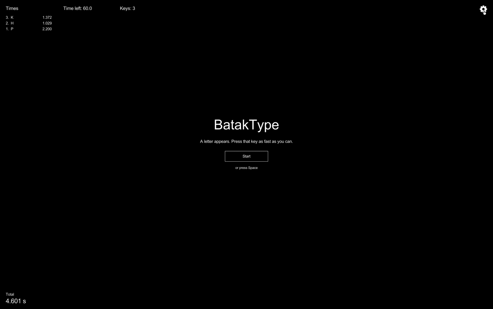
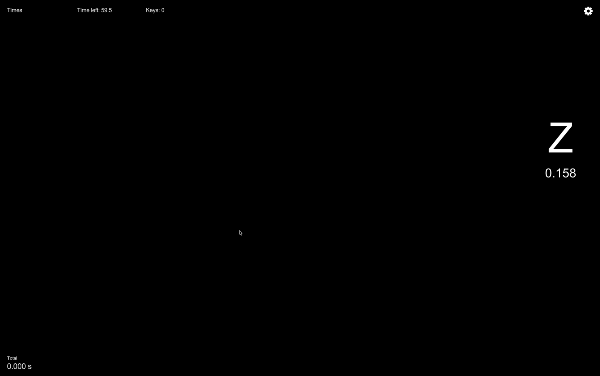
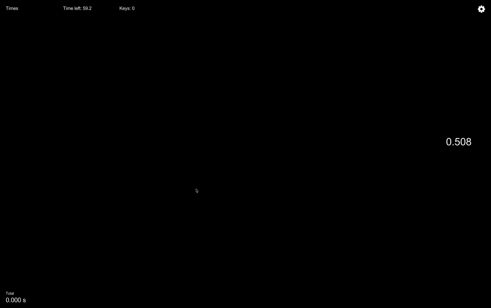
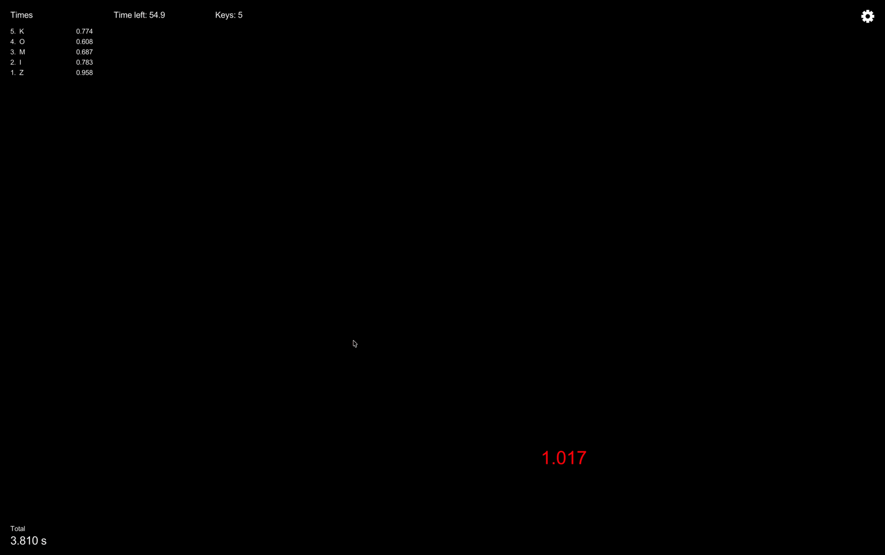
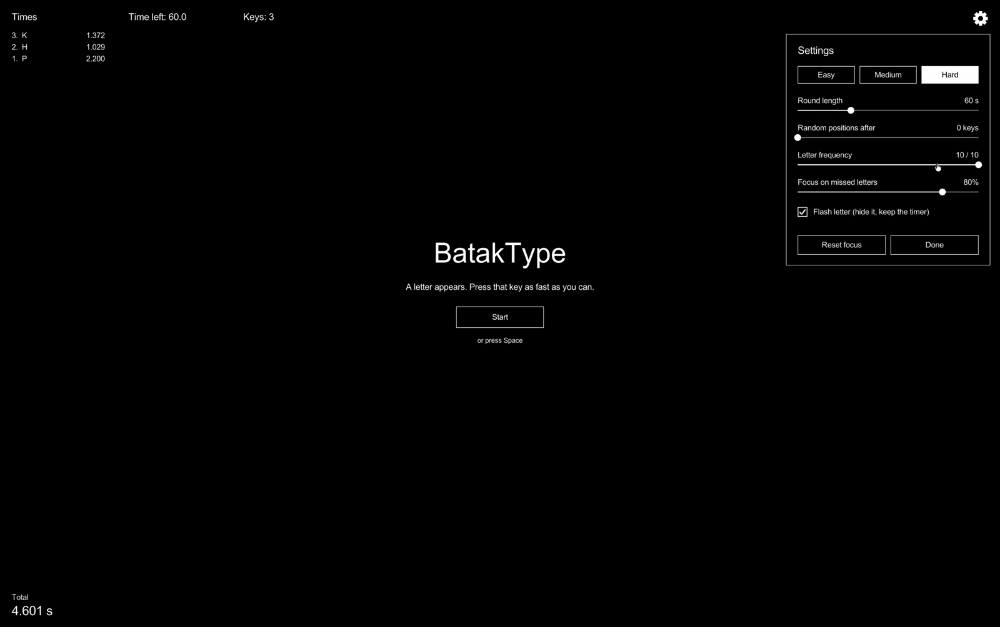

# BatakType 1.0

A Batak-board style reaction trainer for your keyboard, written in C with [raylib](https://www.raylib.com/). Runs as a desktop app or in any modern browser. The web version is a single 380 KB HTML file (about 145 KB to download, compressed).

A letter appears and a timer starts. Hit that key as fast as you can. There are two modes:

- **Casual:** a 60-second round. Every reaction time is listed down the side, and at the end you get your average, total time and information throughput in bits per second. Letters you keep getting wrong come up more often.
- **Competitive:** survive as long as you can. Letters always flash, the game keeps speeding up, and one wrong key, or 5 seconds on a letter, ends the run. Your score is how many letters you got right.



| A letter and its timer | Flash mode: the letter's gone, the timer keeps going |
|---|---|
|  |  |
| **Wrong key: the timer turns red and shakes** | **Settings, on the Hard preset** |
|  |  |

## Versions

### 1.0 (November 2026)

The first full release.

- **Two modes.** The Start button is now two: **Casual** and **Competitive**.
  - **Casual** is the 60-second round with your settings. The results lead with your **average reaction time**. A round also ends early after **3 wrong presses on one letter**, or if a letter sits for **5 seconds**.
  - **Competitive** is a survival run. Letters always flash, the speed keeps rising, focus on missed letters is off so every run is pure random, and **one wrong key or 5 seconds on a letter** ends it. The headline score is **how many letters you got right**.
- **A speed scale that goes to your monitor's limit.** *Letter frequency* used to stop at 10. It now carries on until the letter is on screen for a single refresh of your monitor, at full brightness: level 15 on a 60 Hz screen, 18 at 120 Hz, 20 at 240 Hz. See [the top speed depends on your monitor](#the-top-speed-depends-on-your-monitor).
- **Bits per second.** Both modes report an information throughput: how many bits of information you processed per second, from the Shannon entropy of every pick. See [the maths](Docs/MATHS.md#8-information-throughput-bits-per-second).
- **New presets.** The old Medium is now **Easy**, there is a new **Medium** between it and Hard, and **Hard** is unchanged.
- **A smoother start.** The first time you click Casual, the settings open so you can pick a difficulty. Pressing **Done** in settings goes straight to the 3-2-1 countdown. Rounds start with a click; the Space bar no longer starts one.
- **Reset focus explains itself** when you hover over it.
- **Tidier, fully commented code.** The game is split into three small parts (rules, drawing helpers, the game), every function is explained in plain English, and 15 tests cover the rules. See [Project layout](#project-layout).
- **The maths has its own page**, [Docs/MATHS.md](Docs/MATHS.md).

### Alpha: the proof of concept version

Everything before 1.0 (tagged `alpha` in git).

- **The idea, working:** a letter appears, a timer starts, you hit the key. A 60-second round, every time listed down the side, and a total at the end.
- **Focus on missed letters:** letters you get wrong on the first try come up more often.
- **Random positions** after a set number of keys, and a **flash letter** option that hides the letter after a moment.
- **A settings panel** behind a gear icon, with Easy / Medium / Hard presets and a 1-10 speed scale.
- **Runs in the browser:** the same C code compiled to WebAssembly as a single self-contained 380 KB HTML file, with key presses timed to about 1 ms and sharp text on Retina screens.
- **A plain look:** black background, white Arial text.

## Build and run

You need CMake 3.24+, a C compiler and git. raylib 5.5 is downloaded automatically the first time you configure.

```sh
cmake -B build
cmake --build build
./build/batak_type
```

Run the tests for the game rules (no window needed):

```sh
ctest --test-dir build
```

### In a browser

The same C code compiles to WebAssembly with [Emscripten](https://emscripten.org/). On macOS:

```sh
brew install emscripten
emcmake cmake -B build-web -DCMAKE_BUILD_TYPE=MinSizeRel
cmake --build build-web
open build-web/batak_type.html
```

That gives you one self-contained `batak_type.html`, with the code and font inside it. It renders at your screen's full resolution, so text stays sharp on Retina displays. Double-click it, email it, or put it on any web host; no server setup needed. Add `-DBATAK_WEB_SINGLE_FILE=OFF` to the first `cmake` line to get separate `.html` + `.js` + `.wasm` files instead (a little smaller, but they must be served by a web server rather than opened from disk).

**Play it online:** <https://samuelojo.tech/projects/batak-type/>, with a write-up of the architecture and maths.

## How to play

Click **Casual** or **Competitive** on the menu to start, and **Play again** on the results screen to go again.

| Key | Does |
|---|---|
| `A`-`Z` | Hit the letter on screen |
| `Esc` | Close settings, or leave the round |
| Gear icon | Settings (pauses the round) |

### Casual

- A 60-second round (change it in settings). The results headline is your **average reaction time**, with total time, best and slowest, first-try rate and throughput underneath.
- The round ends early if one letter takes **3 wrong presses**, or sits for **5 seconds** without a press.
- The first time you click Casual, the settings open so you can choose a difficulty. Press **Done** and the countdown starts.

### Competitive

- Starts at Letter frequency 5 and speeds up one level at **5, 12, 22, 36 and 55 seconds**, then keeps climbing more slowly until it reaches the top level for your monitor (see [the maths](Docs/MATHS.md#7-competitive-speed-schedule)).
- Letters **always flash**, so each speed-up also means less time to read the letter.
- **Focus on missed letters is off**, so every run is pure random and runs are comparable.
- **One wrong key, or 5 seconds on a letter, ends the run.** The headline is **how many letters you got right**, with the time you survived, the speed you reached and your best this session.
- Random positions follow your *Random positions after* setting.

### Settings

Open them with the gear. **Done** starts a fresh round with the countdown (Casual from the menu, otherwise the mode you were playing). Esc, the gear, or a click outside the panel just closes it and carries on.

| Setting | What it does |
|---|---|
| Round length | How long a Casual round lasts (10-180 s) |
| Random positions after | How many letters before they start appearing in random places. 0 = from the start, far right = Never |
| Letter frequency | The speed level. Below 8, each level shortens the pause between letters. With flash on, every level also shortens how long the letter is shown |
| Focus on missed letters | How hard the game brings back letters you get wrong (0 = pure random) |
| Flash letter | The letter disappears after a moment; the timer stays until you press the key |
| Reset focus | Forgets which letters you've been missing, so every letter is equally likely again |

The Easy, Medium and Hard buttons set everything except round length. The game starts on Easy.

| | Random positions after | Letter frequency | Focus on missed letters | Flash letter |
|---|---|---|---|---|
| Easy | 10 keys | 5 | 60% | off |
| Medium | 5 keys | 6 | 70% | on (letter shown for 213 ms) |
| Hard | 0 keys | 8 | 80% | on (120 ms) |

### The top speed depends on your monitor

Hard isn't the ceiling. With *Flash letter* on, each level above 8 shows the letter for 25% less time: 90 ms at 9, 68 ms at 10, 38 ms at 12, 21 ms at 14.

A monitor redraws the picture a fixed number of times a second, so nothing can be on screen for less than one refresh. The game never fakes a shorter flash by dimming the letter: it is always drawn at full brightness, and the slider stops at the first level whose flash is as short as a single refresh of **your** monitor. A faster monitor gets a longer scale:

| Monitor | One refresh | Top of the Letter frequency slider |
|---|---|---|
| 60 Hz | 16.7 ms | 15 |
| 120 Hz (e.g. MacBook Pro) | 8.3 ms | 18 |
| 144 Hz | 6.9 ms | 18 |
| 240 Hz | 4.2 ms | 20 |

At the top level the letter is on screen for exactly one frame, which is right at the edge of what people can read: experiments have found viewers can identify images shown for as little as about 13 ms. The settings panel shows your limit next to the slider, for example "8 / 18". Competitive climbs to the same limit. The formula is in [the maths](Docs/MATHS.md#the-limit-depends-on-your-monitor).

---

## How the maths works

The maths has its own page: **[Docs/MATHS.md](Docs/MATHS.md)**. It covers how reaction times are measured to the millisecond (even in a 60 Hz browser), the weighted random picker that brings back the letters you miss, the speed scale and flash times, Competitive's geometric speed schedule, and information throughput in bits per second.

---

## Project layout

```
game/                  the game (C11 + raylib)
  main.c               the game: settings, how a round flows, the screens, input
  core.h / core.c      the rules and the maths (see Docs/MATHS.md). No drawing, fully tested
  ui.h / ui.c          sharp text, buttons, the mouse, the monitor's refresh rate
  font_data.h          embedded 8.8 KB font (see below)
  fonts/OFL.txt        that font's licence
  web/shell.html       the minimal page the browser version runs in
  tests/core_tests.c   15 tests for core.c
app/                   C++ learning version (see Docs/PLAN.md)
Docs/                  the maths page, plan, notes and screenshots
CMakeLists.txt         builds everything, fetches raylib
```

**Reading the code.** Every file starts with a plain-English tour and every function has a comment saying what it does and why, written for someone still learning C. Start with `game/main.c`: its header lists its ten sections in order. `core.c` is the place to see the maths as code.

**Font.** On desktop the game uses Arial from your system (`/System/Library/Fonts/Supplemental/Arial.ttf` on macOS, `C:/Windows/Fonts/arial.ttf` on Windows). A browser can't read your system fonts, so the game also carries *BatakSans*: Liberation Sans (same letter shapes and widths as Arial) cut down to the 95 printable ASCII characters, 8.8 KB instead of 410 KB. It's renamed as its licence (SIL Open Font License) requires for modified versions. The desktop app uses it too if Arial isn't installed.
